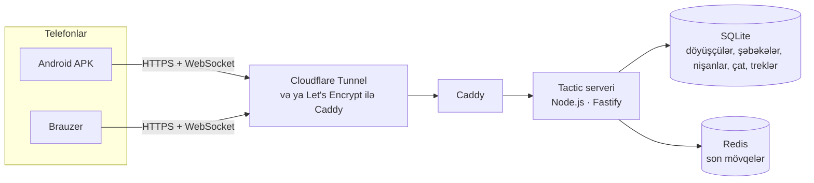
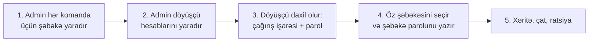

<div align="center">

# Tactic — C2 / Intercom

**Straykbol üçün taktiki xəritə və PTT-ratsiya — öz serverinizdə**

Döyüşçülərin real vaxtda mövqeləri, nişanlar, zonalar, marşrutlar, çat və dəstələr üzrə səsli rabitə —
brauzerdə və ekran sönülü olanda da işləyən Android tətbiqində.

[](https://github.com/Moondancer1/tactic/actions/workflows/ci.yml)
[](https://github.com/Moondancer1/tactic/actions/workflows/android.yml)


[](LICENSE)

[Русский](README.md) · [English](README.en.md) · **Azərbaycanca**

</div>

---

## Mündəricat

- [Bu nədir və nə üçündür](#bu-nədir-və-nə-üçündür)
- [Funksiyalar](#funksiyalar)
- [Necə işləyir](#necə-işləyir)
- [Sürətli başlanğıc](#sürətli-başlanğıc)
- [Tələblər](#tələblər)
- [Yerləşdirmə](#yerləşdirmə)
  - [Variant A — Windows ev kompüteri](#variant-a--windows-ev-kompüteri)
  - [Variant B — Linux VPS](#variant-b--linux-vps)
- [Birinci oyun: admin paneli, şəbəkələr və döyüşçülər](#birinci-oyun-admin-paneli-şəbəkələr-və-döyüşçülər)
- [Döyüşçülər üçün: necə istifadə etməli](#döyüşçülər-üçün-necə-istifadə-etməli)
- [Android tətbiqi (APK)](#android-tətbiqi-apk)
- [Server tənzimləmələri (mühit dəyişənləri)](#server-tənzimləmələri-mühit-dəyişənləri)
- [Yeniləmə və ehtiyat nüsxələr](#yeniləmə-və-ehtiyat-nüsxələr)
- [Təhlükəsizlik](#təhlükəsizlik)
- [Problemlərin həlli](#problemlərin-həlli)
- [Tərtibatçılar üçün](#tərtibatçılar-üçün)
- [Layihənin strukturu](#layihənin-strukturu)
- [Sənədlər](#sənədlər)
- [Lisenziya](#lisenziya)

> Tətbiqin interfeysi rus dilindədir, taktiki işarələr isə ingiliscədir (SAT, RULER, PTT…). `docs/` qovluğundakı ətraflı sənədlər rus dilindədir.

---

## Bu nədir və nə üçündür

Straykbol oyununda komanda **kimin harada olduğunu**, **düşmənin harada olduğunu** bilməli və **əmrləri tez ötürə** bilməlidir. Adətən bunun üçün ratsiyalar, kağız xəritə və qışqırıq istifadə olunur. Tactic bunların hamısını telefonda bir tətbiqdə birləşdirir:

- hər döyüşçü öz yoldaşlarını xəritədə real vaxtda görür;
- düşmənlə kontakt iki toxunuşla qeyd olunur və dərhal bütün komandaya görünür;
- komandir zonalar, marşrutlar və hədəflər çəkir, brifinq yazır;
- səsli rabitə ratsiya kimi işləyir: düyməni basıb saxlayın — danışın, buraxın — dinləyin.

Serveri **özünüz** qurursunuz: ev kompüterində və ya icarəyə götürülmüş VPS-də. Heç bir kənar bulud xidməti, abunə və komandanızın mövqelərini saxlayan yad server yoxdur.

> **Bir şəbəkə = bir komanda.** İki tərəfli oyun üçün administrator fərqli parollarla iki şəbəkə yaradır. Rəqib serverdə hesabı olsa belə, sizin şəbəkənin parolu olmadan xəritənizi görə bilməz.

---

## Funksiyalar

### Xəritə
- Laylar: **SAT** (Esri World Imagery peyk təsviri), **2D** (OpenFreeMap vektor xəritəsi), **3D** (iki barmaqla əyəndə binalar), **TOPO** (OpenTopoMap).
- **Oflayn xəritə**: oyundan əvvəl poliqonun ərazisini endirin — xəritə internetsiz işləyəcək. Endirilmiş ərazi ayrıca saxlanılır və özbaşına silinmir, sadəcə baxılmış xəritənin keşi isə məhduddur və köhnə hissələri avtomatik silinir. Tutulan yer tənzimləmələrdə görünür.
- Döyüşçülərin real vaxtda mövqeləri: çağırış işarəsi, dəstə, rol, baxış istiqaməti (maqnit meyli nəzərə alınmaqla kompasa görə), status və batareya səviyyəsi. Uzun müddət məlumat göndərməyən döyüşçünün işarəsi solğun görünür.
- **50 / 100 / 250 m** addımlı UTM taktiki tor və adlı sektorlar; ekranın mərkəzində **MGRS** koordinatlarını, sizdən və ən yaxın orientirdən məsafəni və azimutu göstərən nişangah.
- **ME** düyməsi: xəritəni öz mövqeyinizə mərkəzləşdirir və təzə mövqeyi dərhal göndərir.
- Xəritəni uzaqlaşdıranda döyüşçülər və nişanlar rəqəmli **klasterlərə** birləşir — yaxınlaşdırmaq üçün klasterə toxunun. Xəritədəki hər şeyi videokart çəkir, buna görə onlarla döyüşçü olanda da ləngimir.
- **Kompasa görə xəritə** (standart olaraq söndürülüb, MAP pərdəsi): xəritə telefonun istiqamətinə görə fırlanır. N düyməsi şimalı yuxarı qaytarır.

### Taktiki nişanlar
| Alət | Nə edir | Kim istifadə edə bilər |
|---|---|---|
| **ENEMY** | Düşmənlə kontakt (növ, say, hərəkətdədirmi, yox olma taymeri) | hamı |
| **MEDIC / DANGER** | SPOT bölməsində sürətli «tibbi yardım lazımdır» və «təhlükəli zona» nişanları | hamı |
| **RULER** | Xətkeş: məsafə və azimut — həqiqi / maqnit, mil ilə | hamı |
| **OBJ** | Statuslu hədəf (aktiv / ələ keçirilib / itirilib / təmizlənib) | komandirlər |
| **TRP** | Səslə hədəf göstərmək üçün adlı orientir («PALIDDAN 200 şimala») | komandirlər |
| **WPT** | Yol nöqtəsi | komandirlər |
| **ROUTE** | Oxlarla dəstə marşrutu | komandirlər |
| **ZONE** | Ştrixlənmiş zona (öz, düşmən, neytral, hədəf, qadağan) | komandirlər |

Komandirlər — **Squad leader** və **Commander** rollarıdır. Oyunda komandir rolunu almaq üçün həmin şəbəkənin **komandir PIN-i** lazımdır.

### Səsli rabitə (Push-To-Talk)
- Üç kanal: **SQD** (öz dəstəniz), **ALL** (şəbəkədəki hamı), **CMD** (yalnız komandirlər).
- Ratsiya kimi işləyir: biri danışarkən kanal məşğuldur. İkinci danışan «Канал занят» (kanal məşğuldur) yazısını görəcək.
- Səs xəritə ilə eyni qorunan kanalla gedir: mobil internet və tunellər üzərindən işləyir, UDP portlarını açmaq lazım deyil.
- Danışmaq üçün: ekrandakı PTT düyməsi, kompüterdə **boşluq** (Space) düyməsi, Android-də **qulaqlığın düyməsi** və (istəyə görə) **səsi azaltma düyməsi** — hətta ekran kilidli olanda da.

### Rabitə və komandanlıq
- **ALL / SQUAD / CMD** kanalları üzrə çat; gələn mesajlar avtomatik səsləndirilir (TTS, rus və ingilis dillərində).
- Döyüşçü statusları **OK / HIT / MEDIC / OUT**: status dəyişəndə dəstəyə yeri göstərilən mesaj gedir.
- Komandirin **brifinqi** şəbəkədəki hər kəsə görünür.
- **Oyunun təhlili**: bütün döyüşçülərin hərəkət trekləri xəritədə — geri-irəli çəkmə, ×10–×120 sürət və son 5 / 15 dəqiqənin və ya bütün yolun «quyruğu» ilə. Komandirlər oyun zamanı BRIEF bölməsindən, administrator isə istənilən şəbəkə, o cümlədən bitmiş şəbəkə üçün açır.
- **TEAM** bölməsi: kim onlayndır, kim oflayndır və istənilən döyüşçünü xəritədə göstərən «НА КАРТУ» düyməsi.

### Android tətbiqi
- **Ekran sönülü olanda** da işləyir: fon xidməti GPS-i özü göndərir və səsli rabitəni saxlayır.
- Enerji rejimləri: **COMBAT** (hər 2 saniyədən bir mövqe, ekran sönmür) və **ECO** (hər 5 saniyədən bir). Döyüşçü yerində dayananda və ya ekran sönülü olanda — hər 15 saniyədən bir.
- Komandaya yalnız təzə və dəqiq koordinatlar göndərilir, GPS «sıçrayışları» olmadan.
- Qrafika **AVTO / TAM / YÜNGÜL**: zəif telefonda — və ya xəritə sürüşdürüləndə ləngiməyə başlayanda — tətbiq özü yüngül qrafikaya keçir (daha az piksel, kölgə və animasiya olmadan).

---

## Necə işləyir



| Komponent | Texnologiyalar |
|---|---|
| Server | Node.js 22+, Fastify, WebSocket, daxili SQLite (`node:sqlite`), Redis, JWT |
| Veb-klient | React 18, Zustand, MapLibre GL, PWA |
| Android | Capacitor 7 + xüsusi plagin və fon xidməti (Java) |
| Yerləşdirmə | Docker Compose, Caddy (HTTPS), Cloudflare Tunnel |

Bütün məlumatlar — döyüşçülər, şəbəkələr, nişanlar, çat və treklər — **yalnız sizin serverinizdə** saxlanılır: `data/` qovluğunda (ev kompüteri) və ya Docker həcmində (VPS).

---

## Sürətli başlanğıc

Ən sadə yol — Windows ev kompüteri və Cloudflare-in müvəqqəti ünvanı (domen lazım deyil):

```powershell
git clone https://github.com/Moondancer1/tactic.git
cd tactic
powershell -ExecutionPolicy Bypass -File scripts\local.ps1
```

1. Birinci sualda **Enter** basın (domensiz), parol sualında da **Enter** basın — skript etibarlı parolu özü yaradacaq.
2. 3–10 dəqiqədən sonra skript `https://….trycloudflare.com` kimi ünvanı və administratorun login/parolunu çap edəcək.
3. Ünvanı açın → **Админ-панель** (admin paneli) → şəbəkə və döyüşçülər yaradın → döyüşçülər öz telefonlarından daxil olur.

Hər addım aşağıda ətraflı izah olunub.

---

## Tələblər

| Harada işə salırsınız | Nə lazımdır |
|---|---|
| **Ev kompüteri** | [Docker Desktop](https://www.docker.com/products/docker-desktop/) quraşdırılmış Windows 10/11. Node.js, Java və Android Studio **lazım deyil** — hər şey Docker daxilində yığılır. |
| **VPS** | Ubuntu 22.04/24.04 və ya Debian 12, 1–2 vCPU, 1–2 GB RAM (30–60 oyunçu üçün 2 vCPU kifayətdir), açıq IPv4 ünvanı və serverə yönəlmiş A-qeydi olan domen. |
| **Telefonlar** | Android 6.0+ (APK) və ya istənilən müasir brauzer. GPS və mikrofon icazəsi tələb olunur. |

> **Vacib.** Server **HTTPS ilə** açılmalıdır. HTTPS olmadan brauzer sayta nə geolokasiya, nə də mikrofon verir, APK isə yalnız HTTPS qəbul edir. Aşağıdakı hər iki variant HTTPS-i avtomatik qurur.

---

## Yerləşdirmə

### Variant A — Windows ev kompüteri

Server sizin kompüterinizdə işləyir, telefonlar isə ona **Cloudflare Tunnel** — pulsuz qorunan tunel vasitəsilə qoşulur. Ağ IP və routerdə port yönləndirmə **lazım deyil**.

#### 1-ci yol. Öz domeninizlə (daimi ünvan)

Cloudflare-ə qoşulmuş domen lazımdır (pulsuz tarif kifayətdir).

1. [Cloudflare Zero Trust](https://one.dash.cloudflare.com/) → **Networks → Tunnels** → **Create a tunnel** → **Cloudflared** növü → ad, məsələn `tactic`.
2. **Tunel tokenini** kopyalayın — `eyJ` ilə başlayan uzun sətir.
3. **Public Hostname** bölməsində marşrut əlavə edin:

   | Sahə | Dəyər |
   |---|---|
   | Subdomain | `tactic` |
   | Domain | sizin domen |
   | Service Type | `HTTP` |
   | URL | `caddy:80` |

4. Layihə qovluğunda PowerShell-də işə salın:
   ```powershell
   powershell -ExecutionPolicy Bypass -File scripts\local.ps1
   ```
5. Skript soruşacaq:
   - **ünvan** — `https://tactic.sizin-domen.com` daxil edin;
   - **tunel tokeni** — 2-ci addımdakı tokeni yapışdırın;
   - **admin parolu** — özünüzünkünü yazın (ən azı 10 simvol) və ya təsadüfi parol yaradılması üçün Enter basın.

   Cavablar təsadüfi `JWT_SECRET` ilə birlikdə `.env.local` faylında saxlanılır. Bu fayl **sizin gizli məlumatlarınızdır**: git-ə düşmür, onun surətini etibarlı yerdə saxlayın.

#### 2-ci yol. Domensiz (müvəqqəti ünvan)

Həmin skripti işə salın və birinci sualda **Enter** basın. Cloudflare `https://xxxx.trycloudflare.com` kimi ünvan verəcək, skript onu çap edəcək.

> Müvəqqəti ünvan **tunel hər dəfə yenidən başladılanda dəyişir** — döyüşçülər onu yenidən daxil etməli olacaq. Müntəzəm oyunlar üçün öz domeninizdən istifadə edin.

#### Kompüterdə serverin idarə olunması

| Əməliyyat | Əmr |
|---|---|
| İşə salmaq və ya `git pull`-dan sonra yeniləmək | `powershell -ExecutionPolicy Bypass -File scripts\local.ps1` |
| Dayandırmaq (`data\` qovluğundakı baza saxlanılır) | `powershell -ExecutionPolicy Bypass -File scripts\local.ps1 -Down` |
| Server loglarına baxmaq | `docker compose -f docker-compose.local.yml logs -f app` |

Ətraflı: [docs/LOCAL.md](docs/LOCAL.md) (rus dilində).

---

### Variant B — Linux VPS

Server pulsuz Let's Encrypt HTTPS sertifikatını avtomatik alır.

1. Domeninizin DNS-də **A-qeydi** yaradın, məsələn `tactic.example.com` → VPS-in IP ünvanı.
2. Docker-i quraşdırın və layihəni endirin:
   ```bash
   curl -fsSL https://get.docker.com | sudo sh
   git clone https://github.com/Moondancer1/tactic.git
   cd tactic
   ```
3. Quraşdırıcını öz domeniniz və e-poçtunuzla işə salın (Let's Encrypt bildirişləri üçün):
   ```bash
   sudo ./scripts/install.sh tactic.example.com admin@example.com
   ```

Quraşdırıcı özü:
- sistemi, Docker-i, DNS-qeydini və **80/443** portlarının boş olub-olmadığını yoxlayacaq;
- **təsadüfi** gizli açarlarla (`JWT_SECRET`, `ADMIN_PASSWORD`, `ADMIN_TOKEN`) `.env` faylı yaradacaq və admin panelinin loginini göstərəcək;
- `ufw`-də portları açacaq (əgər aktivdirsə), `caddy`, `app`, `redis` konteynerlərini yığıb işə salacaq;
- serverin cavab verdiyini yoxlayacaq.

> **80/443 portlarını** artıq başqa nginx/Caddy tutub? Quraşdırıcı özü `proxy` rejiminə keçəcək: Tactic `127.0.0.1:8088` ünvanında dinləyəcək, mövcud proksiniz isə domeni ona yönləndirməlidir (WebSocket dəstəyi ilə). nginx nümunəsi [docs/DEPLOY.md](docs/DEPLOY.md) faylındadır.

Heç nəyi dəyişmədən yalnız serveri yoxlamaq:
```bash
sudo ./scripts/install.sh --check tactic.example.com admin@example.com
```

---

## Birinci oyun: admin paneli, şəbəkələr və döyüşçülər



1. **Admin panelini açın.** Server ünvanını açın → giriş ekranının aşağısında **«Админ-панель (бойцы и сети)»** (admin paneli) → `.env.local` (kompüter) və ya `.env` (VPS) faylındakı administrator logini və parolu. Standart login — `administrator`.

2. **Şəbəkələr yaradın.** **«Новая сеть»** (yeni şəbəkə) blokunda:
   - **Ad** — məsələn `Op. Nightfall — GÖYLƏR`;
   - **Şəbəkə parolu** (ən azı 4 simvol) — onu **yalnız öz komandanıza** verin;
   - **Komandir PIN-i** — boş saxlayın, server 6 rəqəmli təsadüfi PIN yaradacaq.

   Hər şəbəkənin PIN-i **«Активные сети»** (aktiv şəbəkələr) siyahısında görünür. Onu yalnız komandirlərə verin.

3. **Döyüşçülər yaradın.** **«Добавить / обновить бойца»** (döyüşçü əlavə et / yenilə) blokunda: çağırış işarəsi (2–16 simvol: hərflər, rəqəmlər, defis), parol (ən azı 6 simvol), standart dəstə və rol.
   - **ИЗМ.** (dəyiş) — parolu, dəstəni və ya rolu dəyişmək. Yeni parol döyüşçünün bütün köhnə sessiyalarını dərhal bağlayır.
   - **КИК** (çıxar) — döyüşçünü dərhal bütün şəbəkələrdən çıxarmaq; o, yenidən daxil olmalı olacaq.
   - **✕** — hesabı silmək.

4. **Döyüşçülər daxil olur.** Telefonda: çağırış işarəsi və parol → şəbəkələr siyahısı → öz şəbəkəsi → şəbəkə parolu.

5. **Oyundan sonra** şəbəkənin yanındakı **ЗАВЕРШИТЬ** (bitir) düyməsini basın — bütün döyüşçülər ayrılacaq, tarixçə (çat, treklər) isə `RETENTION_DAYS` müddətində saxlanılacaq.

### Rollar və hüquqlar

| Kim | Nə edə bilər |
|---|---|
| **İstənilən döyüşçü** | Öz şəbəkəsinin xəritəsini görmək, kontakt / MEDIC / DANGER qoymaq, **öz** nişanlarını silmək, başqasının kontaktını təsdiqləmək («STILL THERE»), ALL və öz dəstəsinə yazmaq, SQD və ALL kanallarında danışmaq |
| **Komandir** (Squad leader, Commander) | Yuxarıdakıların hamısı + hədəflər, orientirlər, yol nöqtələri, marşrutlar, zonalar, brifinq, istənilən nişanı silmək, CMD kanalı |
| **Administrator** | Şəbəkələri yaratmaq və bitirmək, hesabları idarə etmək (admin panelində və ya API ilə) |

Oyunda komandir olmaq üçün: **TEAM** bölməsi → komandir rolunu və ya HQ dəstəsini seçin → **komandir PIN-ini** daxil edin. 5 səhv cəhddən sonra PIN daxil etmək 15 dəqiqəlik bloklanır.

---

## Döyüşçülər üçün: necə istifadə etməli

| Ekran elementi | Təyinatı |
|---|---|
| **Yuxarı panel** | Şəbəkənin adı (şəbəkəni dəyişmək üçün toxunun), **● X/Y В СЕТИ** (onlayn sayı), rabitə vəziyyəti, **COMBAT / ECO** enerji rejimi |
| **Sol alətlər paneli** | RULER, ENEMY və (komandirlər üçün) TRP, OBJ, WPT, ROUTE, ZONE |
| **Xəritə düymələri** | Laylar və tor, şimal yuxarı, tor açıq/bağlı, **ME** — öz mövqeyinə |
| **PTT düyməsi** | Danışmaq üçün basıb saxlayın. Kanal (SQD / ALL / CMD) onun üstündə seçilir |
| **Aşağı pərdə** | **CHAT**, **SPOT** (düşmən haqqında məruzə), **BRIEF** (brifinq), **TEAM** (döyüşçülər, status, rol), **SETTINGS** bölmələri |

**Düşməni qeyd etmək:** xəritəyə uzun basın (və ya ENEMY alətindən istifadə edin) → SPOT bölməsi → növ, say, hərəkətdədirmi, nişan nə vaxt yox olsun → **göndər**. Kontaktı hamı görəcək, çata isə koordinatlı sətir gedəcək.

**Hər oyundan əvvəl:** Tənzimləmələr → **ОФЛАЙН-КАРТА** (oflayn xəritə) → lazım olan hər lay üçün poliqonun ərazisini endirin.

---

## Android tətbiqi (APK)

### Haradan almaq olar

- **Serverinizdən:** `https://sizin-ünvan/tactic.apk` — APK yığıldıqdan sonra əlçatandır (aşağıya baxın).
- **GitHub Actions-dan** — əgər repozitoriyada imza sirləri qurulubsa ([docs/ANDROID.md](docs/ANDROID.md) faylına baxın).

### Yığılma

```powershell
powershell -ExecutionPolicy Bypass -File apk\build-apk.ps1
```

- `.env.local` faylındakı `PUBLIC_URL` server ünvanı tətbiqə yazılır — döyüşçülər onu daxil etməli olmayacaq. Başqa ünvan üçün: `-Server https://tactic.example.com` parametri.
- Node.js, JDK 21 və Android SDK quraşdırılmayıbsa, yığılma **Docker daxilində** gedir (ilk dəfə 5–15 dəqiqə).
- Nəticə: **`apk\out\tactic.apk`** — server onu dərhal `/tactic.apk` ünvanında paylamağa başlayır.
- Yalnız **sizin açarınızla imzalanmış release versiyası** yığılır.

> **İmza açarı — ən vacib hissədir.** İlk yığılmada `apk\keystore\tactic-release.jks` faylı yaradılır, onun parolları isə `.env.local` faylına əlavə olunur. **Hər ikisini etibarlı yerdə saxlayın** (məsələn, şəxsi repozitoriyada). Açar itərsə, yeni versiyalar köhnənin üzərinə quraşdırılmayacaq — hər döyüşçü tətbiqi silib yenidən quraşdırmalı olacaq.

### Telefona quraşdırma

1. APK-nı endirin və açın, naməlum mənbələrdən quraşdırmaya icazə verin.
2. Daxil olun və **geolokasiyaya**, **mikrofona** və **bildirişlərə** icazə verin.
3. Tənzimləmələr → **ФОНОВАЯ РАБОТА** (fon rejimi) → fonda işləməyə icazə verin (batareya optimallaşdırmasını söndürür).
4. Xiaomi, Huawei, Samsung telefonlarında əlavə olaraq Tactic üçün avtomatik başlamanı aktivləşdirin və fon məhdudiyyətlərini götürün (öz modeliniz üçün təlimat: [dontkillmyapp.com](https://dontkillmyapp.com)).
5. Oflayn xəritəni endirin.

Tətbiq fonda işləyəndə bildiriş pərdəsində «Tactic: GPS … · radio listening» görünür. Bildirişdəki **Stop** düyməsi fon işini dayandırır.

---

## Server tənzimləmələri (mühit dəyişənləri)

`.env.local` (kompüter) və ya `.env` (VPS) faylında təyin olunur. `local.ps1` və `gen-env.sh` skriptləri onları özləri yaradır.

| Dəyişən | Məcburidir | Təsvir |
|---|---|---|
| `JWT_SECRET` | bəli | Sessiyaların imza açarı, ən azı 32 təsadüfi simvol |
| `ADMIN_USER` | — | Admin panelinin logini (standart olaraq `administrator`) |
| `ADMIN_PASSWORD` | bəli* | Admin panelinin parolu, ən azı 10 simvol. Boşdursa, admin paneli söndürülür |
| `ADMIN_TOKEN` | — | Skriptlər və webhook üçün token (`Authorization: Bearer …`) |
| `RETENTION_DAYS` | — | Çat, treklər və bitmiş şəbəkələr neçə gün saxlanılsın (standart olaraq `30`) |
| `CORS_ORIGINS` | — | API-yə müraciət etməyə icazə verilən əlavə ünvanlar (vergüllə). Tətbiqin özünə bu lazım deyil |
| `DOMAIN`, `ACME_EMAIL` | VPS | Let's Encrypt sertifikatı üçün domen və e-poçt |
| `PUBLIC_URL` | Kompüter | Server ünvanı: `local.ps1` onu göstərir, `build-apk.ps1` isə APK-ya yazır |
| `CLOUDFLARE_TUNNEL_TOKEN` | Kompüter | Adlı tunelin tokeni. Boşdursa — müvəqqəti trycloudflare.com ünvanı |
| `TACTIC_KEYSTORE_PASSWORD`, `TACTIC_KEY_ALIAS`, `TACTIC_KEY_PASSWORD` | APK | İmza açarının parolları (avtomatik yaradılır) |

\* İş rejimində gizli açarlar minimumdan qısadırsa və ya `.env.example` / `.env.local.example` nümunələrindəki dəyərlərlə üst-üstə düşürsə, server **işə düşməkdən imtina edir**. Bu, təsadüfən ictimaiyyətə məlum parollarla işə salınmadan qorunmadır.

---

## Yeniləmə və ehtiyat nüsxələr

**Kompüterdə yeniləmə:**
```powershell
git pull
powershell -ExecutionPolicy Bypass -File scripts\local.ps1
```

**VPS-də yeniləmə:**
```bash
git pull
sudo ./scripts/install.sh tactic.example.com admin@example.com
```

Döyüşçülər avtomatik yenidən qoşulur. Yeniləmə zamanı verilənlər bazası saxlanılır və lazım olduqda özü yeni struktura keçirilir.

**Ehtiyat nüsxə:**
- **Kompüter:** `data\` qovluğunu (yaxşı olar ki, server dayandırılmış halda) və `.env.local` faylını `apk\keystore\` qovluğu ilə birlikdə kopyalayın.
- **VPS:** [docs/DEPLOY.md](docs/DEPLOY.md#7-резервные-копии) faylındakı əmr bazanın surətini serveri dayandırmadan çıxarır.

**Oyundan sonrakı təhlil:** bütün döyüşçülərin treklərini (hər 10 saniyədən bir nöqtə) administrator hüquqları ilə `GET /api/admin/matches/<id>/tracks` sorğusu ilə almaq olar.

---

## Təhlükəsizlik

Tactic **rəqibin də telefonu, hesabı və gizlicə baxmaq istəyi ola bilər** fərziyyəsi ilə layihələndirilib.

- **Komandaların təcrid olunması.** Bir şəbəkənin xəritəsi, nişanları və çatı digərindən əlçatan deyil. Şəbəkələr siyahısı yalnız daxil olduqdan sonra görünür, şəbəkə kodları açıqlanmır, şəbəkə parolu məcburidir. Server özü açıq şəbəkə yaratmır, köhnə açıq «Tactic Server» şəbəkəsini isə işə düşəndə bağlayır.
- **Komandir PIN-i yalnız öz şəbəkəsində işləyir.** PIN ilə alınan rol hesaba yazılmır və başqa şəbəkələrə keçmir. Administratorun döyüşçü kartında verdiyi rol isə hər yerdə işləyir.
- **Parollar telefonda saxlanılmır.** Daxil olduqdan sonra tətbiq yalnız ləğv edilə bilən bileti saxlayır.
- **Girişin dərhal ləğvi.** Döyüşçünün çıxarılması, silinməsi və ya parolunun dəyişdirilməsi onun bütün sessiyalarını, o cümlədən fonda GPS göndərilməsini dərhal kəsir.
- **Parol seçməyə qarşı qoruma.** Giriş: 10 səhv parol «çağırış işarəsi + ünvan» cütünü 15 dəqiqəlik bloklayır — başqasının cəhdləri əsl döyüşçünün girişini bağlaya bilməz. Şəbəkə parolu — 8 cəhd, komandir PIN-i — döyüşçü başına 5 cəhd. Admin paneli — 10 səhv giriş həmin ünvanı 15 dəqiqəlik bloklayır, başqa ünvandakı admina isə təsir etmir.
- **Dürüst mövqelər.** Vaxtı server qoyur; 40 m/s-dən sürətli «teleportlar» və qeyri-dəqiq ölçmələr atılır.
- **Başqasının nişanlarına toxunmaq olmaz.** Nişanı yalnız onun müəllifi və ya komandir dəyişə və silə bilər.
- **Veb-klientin qorunması.** CSP siyasəti tətbiqin öz fayllarından başqa heç bir skriptin icrasına icazə vermir.
- **Qorunan APK.** Release yığılması, məlumatların ehtiyat nüsxəsi və sazlama olmadan, yalnız HTTPS və yalnız sistem sertifikatları ilə.
- **Avtomatik test.** [`server/test/security-smoke.mjs`](server/test/security-smoke.mjs) bütün qorumaları başdan-sona ssenari ilə yoxlayır və hər dəyişiklikdə CI-da işə düşür.

Zəiflik tapdınız? Xahiş edirik, onu açıq Issues-da dərc etməyin — repozitoriyanın müəllifi ilə birbaşa əlaqə saxlayın.

---

## Problemlərin həlli

| Problem | Nə etməli |
|---|---|
| Brauzer GPS-ə və ya mikrofona icazə vermir | Sayt HTTPS ilə açılmayıb. `https://…` ünvanından istifadə edin |
| «Неверный позывной или пароль» (yanlış çağırış işarəsi və ya parol) | Klaviatura dilini yoxlayın. Hesabları yalnız administrator yaradır |
| «Слишком много неудачных попыток» (çox sayda uğursuz cəhd) | 15 dəqiqə gözləyin və ya admindən parolu dəyişməyi xahiş edin |
| Server işə düşmür, logda `is a public example value` yazılıb | `.env` / `.env.local` faylında nümunə dəyər qalıb. Həmin sətri silin və `local.ps1` (kompüter) və ya `gen-env.sh` (VPS) işə salın |
| PTT basanda «Канал занят» (kanal məşğuldur) | Bu kanalda artıq başqa döyüşçü danışır — onun ötürməsinin bitməsini gözləyin |
| Ekran sönülü olanda mövqe yenilənmir | Fonda işləməyə icazə verin ([Telefona quraşdırma](#telefona-quraşdırma) bölməsinə baxın) |
| Yeni APK köhnənin üzərinə quraşdırılmır | O, başqa açarla imzalanıb. Köhnə tətbiqi silin və yenisini quraşdırın |
| Müvəqqəti trycloudflare ünvanı işləməyi dayandırdı | O, yenidən başladılanda dəyişir. Yenisini `local.ps1` çıxışından götürün və ya öz domeninizdən istifadə edin |
| Yuxarı paneldə qırmızı nöqtə və `NET…` | Serverlə əlaqə yoxdur, tətbiq özü yenidən qoşulur. Kömək etmirsə və öz proksinizdən istifadə edirsinizsə — onun WebSocket-i ötürdüyünü yoxlayın |

---

## Tərtibatçılar üçün

```bash
npm install
npm run dev          # :3000 portunda server + isti yenidənyükləmə ilə Vite
npm run typecheck    # bütün paketlərin tiplərinin yoxlanması
npm run build        # server və klientin yığılması
```

İnkişaf rejimində admin panelinə `admin` logini və `admin` parolu ilə daxil olmaq olar.

İnkişaf rejimində işləyən serverə qarşı başdan-sona təhlükəsizlik testi:
```bash
npm run build -w server
cd server && DATA_DIR=./data-test node dist/index.js &
node test/security-smoke.mjs http://127.0.0.1:3000
```

REST və WebSocket protokolu [docs/PROTOCOL.md](docs/PROTOCOL.md) faylında təsvir olunub. Pull request-lər xoşdur: göndərməzdən əvvəl `npm run typecheck` əmrinin və təhlükəsizlik testinin keçdiyinə əmin olun.

---

## Layihənin strukturu

```text
tactic/
├── shared/src/index.ts          # Protokol: mesaj tipləri və sxemləri, rollar, dəstələr, kanallar, hüquqlar
├── server/
│   ├── src/
│   │   ├── index.ts             # Fastify, CORS, PWA paylanması, düzgün dayandırma
│   │   ├── config.ts            # Tənzimləmələr və işə salınarkən gizli açarların yoxlanması
│   │   ├── auth.ts              # Dərhal ləğv edilə bilən sessiyalar və biletlər (JWT)
│   │   ├── db.ts                # SQLite: döyüşçülər, şəbəkələr, nişanlar, çat, treklər + miqrasiyalar
│   │   ├── hub.ts               # Şəbəkə otaqları: mövqelər, hüquqlar, səs, limitlər
│   │   ├── ws.ts                # WebSocket: giriş və mesaj mübadiləsi
│   │   └── routes.ts            # REST API
│   ├── test/security-smoke.mjs  # Başdan-sona təhlükəsizlik testi
│   └── Dockerfile
├── client/
│   ├── src/                     # React tətbiqi: xəritə, ratsiya, çat, admin paneli
│   └── android/                 # Android layihəsi (MainActivity, TacticalPlugin, TacticalService)
├── apk/                         # APK yığılması: build-apk.ps1, Dockerfile, keystore/ (git-də deyil), out/
├── deploy/                      # Caddy konfiqurasiyaları
├── scripts/                     # local.ps1 (kompüter), install.sh və gen-env.sh (VPS)
├── docs/                        # Ətraflı sənədlər (rus dilində)
├── docker-compose.yml           # VPS üçün stek: caddy + app + redis
├── docker-compose.local.yml     # Kompüter üçün stek: app + redis + caddy + Cloudflare Tunnel
└── docker-compose.proxy.yml     # 80/443 portları artıq tutulmuş VPS üçün əlavə
```

---

## Sənədlər

Ətraflı sənədlər rus dilindədir.

| Sənəd | Mövzu |
|---|---|
| [docs/LOCAL.md](docs/LOCAL.md) | Öz kompüterinizdə işə salma |
| [docs/DEPLOY.md](docs/DEPLOY.md) | VPS: portlar, proksi, API ilə şəbəkə yaratma, ehtiyat nüsxələr, diaqnostika |
| [docs/ANDROID.md](docs/ANDROID.md) | Android: fon rejimi, yığılma, imzalama, GitHub Actions |
| [docs/PROTOCOL.md](docs/PROTOCOL.md) | REST, WebSocket, tokenlər, limitlər, hakim skriptləri üçün webhook |
| [docs/TESTING.md](docs/TESTING.md) | Avtomatik testlər və oyundan əvvəl sahə yoxlaması siyahısı |

---

## Lisenziya

Layihə **[PolyForm Noncommercial 1.0.0](LICENSE)** lisenziyası ilə yayılır.

| Olar — pulsuz və icazəsiz | Müəllifin yazılı icazəsi olmadan olmaz |
|---|---|
| Özünüz, komandanız və həvəskar oyunlar üçün istifadə etmək | Proqramı və ya onun dəyişdirilmiş versiyasını satmaq |
| Öz serverinizdə yerləşdirmək | Onun əsasında pullu xidmət və ya abunə yaratmaq |
| Kodu öyrənmək və dəyişdirmək | Kommersiya fəaliyyətində istifadə etmək, məsələn, pullu poliqonda |
| Nüsxələri, o cümlədən dəyişdirilmişləri paylaşmaq — [LICENSE](LICENSE) faylını və müəllifin göstərildiyi `Required Notice` sətrini saxlamaq şərtilə | Müəllifin adını və lisenziya şərtlərini silmək |

Qeyri-kommersiya təşkilatları — xeyriyyə, təhsil və dövlət qurumları — da pulsuz istifadə edə bilər.

Tactic-dən kommersiya məqsədilə istifadə etmək istəyirsiniz? Ayrıca icazəni müzakirə etmək üçün müəlliflə [GitHub](https://github.com/Moondancer1) vasitəsilə əlaqə saxlayın.

Copyright © 2026 [Moondancer1](https://github.com/Moondancer1).
