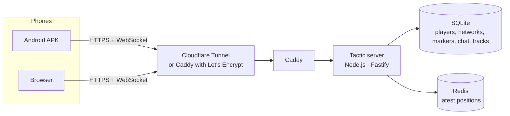
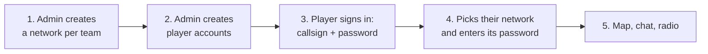

<div align="center">

# Tactic — C2 / Intercom

**A tactical map and push-to-talk radio for airsoft, running on your own server**

Live player positions, markers, zones, routes, chat and squad voice comms —
in the browser and in an Android app that keeps working with the screen off.

[](https://github.com/Moondancer1/tactic/actions/workflows/ci.yml)
[](https://github.com/Moondancer1/tactic/actions/workflows/android.yml)


[](LICENSE)

[Русский](README.md) · **English** · [Azərbaycanca](README.az.md)

</div>

---

## Contents

- [What it is and why](#what-it-is-and-why)
- [Features](#features)
- [How it works](#how-it-works)
- [Quick start](#quick-start)
- [Requirements](#requirements)
- [Deployment](#deployment)
  - [Option A — Windows home PC](#option-a--windows-home-pc)
  - [Option B — Linux VPS](#option-b--linux-vps)
- [First game: admin panel, networks and players](#first-game-admin-panel-networks-and-players)
- [For players: how to use it](#for-players-how-to-use-it)
- [Android app (APK)](#android-app-apk)
- [Server settings (environment variables)](#server-settings-environment-variables)
- [Updates and backups](#updates-and-backups)
- [Security](#security)
- [Troubleshooting](#troubleshooting)
- [Development](#development)
- [Project structure](#project-structure)
- [Documentation](#documentation)
- [License](#license)

> The app interface is in Russian with English tactical labels (SAT, RULER, PTT…). The detailed documents in `docs/` are in Russian.

---

## What it is and why

During an airsoft game a team needs to know **where everyone is**, **where the enemy is**, and **how to pass orders fast**. Usually that means radios, a paper map and shouting. Tactic puts it all into one app on the phone:

- every player sees their teammates on the map in real time;
- an enemy contact is marked with two taps and is instantly visible to the whole team;
- the commander draws zones, routes and objectives and writes the briefing;
- voice works like a radio: hold the button to talk, release to listen.

You host the server **yourself**, on a home PC or a rented VPS. No third-party cloud, no subscriptions, and no one else's server holding your team's positions.

> **One network = one team.** For a two-sided game the administrator creates two networks with different passwords. Even with an account on the server, the other side cannot see your map without your network's password.

---

## Features

### Map
- **SAT** (Esri World Imagery satellite), **2D** (OpenFreeMap vector map), **3D** (buildings when tilted with two fingers) and **TOPO** (OpenTopoMap) layers.
- **Offline map**: download the playing area before the game and the map works without internet.
- Live player positions: callsign, squad, role, facing direction (compass, corrected for magnetic declination), status and battery level. A player who has not reported for a while is shown faded.
- UTM tactical grid of **50 / 100 / 250 m** with named sectors, plus a centre crosshair showing **MGRS** coordinates, range and bearing from you and from the nearest reference point.
- **ME** button: centre the map on yourself and send a fresh position immediately.

### Tactical markings
| Tool | What it does | Who can use it |
|---|---|---|
| **ENEMY** | Enemy contact (type, count, moving or not, disappear timer) | everyone |
| **MEDIC / DANGER** | Quick "medic needed" and "danger area" markers on the SPOT tab | everyone |
| **RULER** | Range and bearing: true / magnetic, in mils | everyone |
| **OBJ** | Objective with status (active / captured / lost / cleared) | commanders |
| **TRP** | Named reference point for voice target calls ("from OAK, 200 north") | commanders |
| **WPT** | Waypoint | commanders |
| **ROUTE** | Squad route with arrows | commanders |
| **ZONE** | Hatched area (friendly, hostile, neutral, objective, restricted) | commanders |

Commanders are the **Squad leader** and **Commander** roles. Taking a command role in a game requires that network's **command PIN**.

### Voice (push-to-talk)
- Three channels: **SQD** (your squad), **ALL** (everyone in the network), **CMD** (commanders only).
- Works like a radio: while one person talks, the channel is busy. A second speaker sees "Канал занят" (channel busy).
- Voice travels over the same secure connection as the map, so it works over mobile data and tunnels with no UDP ports to open.
- Talk with: the on-screen PTT button, the **space bar** on a computer, the **headset button** and (optionally) the **volume-down key** on Android — even with the screen locked.

### Communication and command
- Chat in **ALL / SQUAD / CMD** channels with automatic read-aloud of incoming messages (text-to-speech, Russian and English).
- Player status **OK / HIT / MEDIC / OUT**: on a change, the squad gets a message with the location.
- The commander's **briefing** is visible to everyone in the network.
- **TEAM** tab: who is online, who is offline, and a "НА КАРТУ" (show on map) button for any player.

### Android app
- Works with the **screen off**: a background service sends GPS by itself and keeps voice running.
- Power modes: **COMBAT** (position every 2 s, screen stays on) and **ECO** (every 5 s). When the player is standing still or the screen is off, every 15 s.
- Only fresh, accurate positions are shared with the team — no GPS "jumps".

---

## How it works



| Component | Technology |
|---|---|
| Server | Node.js 22+, Fastify, WebSocket, built-in SQLite (`node:sqlite`), Redis, JWT |
| Web client | React 18, Zustand, MapLibre GL, PWA |
| Android | Capacitor 7 + a custom plugin and background service (Java) |
| Deployment | Docker Compose, Caddy (HTTPS), Cloudflare Tunnel |

All data — players, networks, markers, chat and tracks — is stored **only on your server**, in the `data/` folder (home PC) or a Docker volume (VPS).

---

## Quick start

The simplest path is a Windows home PC with a temporary Cloudflare address (no domain needed):

```powershell
git clone https://github.com/Moondancer1/tactic.git
cd tactic
powershell -ExecutionPolicy Bypass -File scripts\local.ps1
```

1. Press **Enter** at the first question (no domain), and **Enter** again at the password question — the script generates a strong password for you.
2. After 3–10 minutes the script prints an address like `https://….trycloudflare.com` and the admin login and password.
3. Open the address → **Админ-панель** (admin panel) → create a network and players → players sign in from their phones.

Every step is explained in detail below.

---

## Requirements

| Where you run it | What you need |
|---|---|
| **Home PC** | Windows 10/11 with [Docker Desktop](https://www.docker.com/products/docker-desktop/). Node.js, Java and Android Studio are **not required** — everything builds inside Docker. |
| **VPS** | Ubuntu 22.04/24.04 or Debian 12, 1–2 vCPU, 1–2 GB RAM (2 vCPU is enough for 30–60 players), a public IPv4 address and a domain with an A record pointing to the server. |
| **Phones** | Android 6.0+ (APK) or any modern browser. GPS and microphone permission are required. |

> **Important.** The server must be reachable **over HTTPS**. Without HTTPS the browser blocks location and microphone access, and the APK only accepts HTTPS. Both options below set up HTTPS automatically.

---

## Deployment

### Option A — Windows home PC

The server runs on your computer and phones reach it through **Cloudflare Tunnel**, a free secure tunnel. You do **not** need a public IP or port forwarding on your router.

#### Variant 1. With your own domain (permanent address)

You need a domain added to Cloudflare (the free plan is fine).

1. Open [Cloudflare Zero Trust](https://one.dash.cloudflare.com/) → **Networks → Tunnels** → **Create a tunnel** → type **Cloudflared** → a name, for example `tactic`.
2. Copy the **tunnel token** — a long string starting with `eyJ`.
3. On the **Public Hostname** tab add a route:

   | Field | Value |
   |---|---|
   | Subdomain | `tactic` |
   | Domain | your domain |
   | Service Type | `HTTP` |
   | URL | `caddy:80` |

4. Run in PowerShell from the project folder:
   ```powershell
   powershell -ExecutionPolicy Bypass -File scripts\local.ps1
   ```
5. The script asks for:
   - the **address** — enter `https://tactic.your-domain.com`;
   - the **tunnel token** — paste the token from step 2;
   - the **admin password** — type your own (10+ characters) or press Enter to have a random one generated.

   The answers are saved to `.env.local` together with a random `JWT_SECRET`. This file holds **your secrets**: it is never committed to git — keep a copy somewhere safe.

#### Variant 2. Without a domain (temporary address)

Run the same script and press **Enter** at the first question. Cloudflare issues an address like `https://xxxx.trycloudflare.com`, which the script prints.

> The temporary address **changes every time the tunnel restarts**, so players have to enter it again. For regular games, use your own domain.

#### Managing the server on a PC

| Action | Command |
|---|---|
| Start, or update after `git pull` | `powershell -ExecutionPolicy Bypass -File scripts\local.ps1` |
| Stop (the database in `data\` is kept) | `powershell -ExecutionPolicy Bypass -File scripts\local.ps1 -Down` |
| View server logs | `docker compose -f docker-compose.local.yml logs -f app` |

More details: [docs/LOCAL.md](docs/LOCAL.md) (in Russian).

---

### Option B — Linux VPS

The server gets a free Let's Encrypt HTTPS certificate automatically.

1. In your domain's DNS create an **A record**, for example `tactic.example.com` → your VPS IP.
2. Install Docker and download the project:
   ```bash
   curl -fsSL https://get.docker.com | sudo sh
   git clone https://github.com/Moondancer1/tactic.git
   cd tactic
   ```
3. Run the installer with your domain and an email address (for Let's Encrypt notices):
   ```bash
   sudo ./scripts/install.sh tactic.example.com admin@example.com
   ```

The installer will:
- check the system, Docker, the DNS record and whether ports **80/443** are free;
- create a `.env` file with **random** secrets (`JWT_SECRET`, `ADMIN_PASSWORD`, `ADMIN_TOKEN`) and show the admin panel login;
- open the ports in `ufw` (if it is enabled), build and start the `caddy`, `app` and `redis` containers;
- check that the server responds.

> **Ports 80/443 already taken** by another nginx/Caddy? The installer switches to `proxy` mode on its own: Tactic listens on `127.0.0.1:8088`, and your existing proxy must forward the domain to it (with WebSocket support). An nginx example is in [docs/DEPLOY.md](docs/DEPLOY.md).

To only check the server without changing anything:
```bash
sudo ./scripts/install.sh --check tactic.example.com admin@example.com
```

---

## First game: admin panel, networks and players



1. **Open the admin panel.** Open the server address → at the bottom of the login screen, **«Админ-панель (бойцы и сети)»** (admin panel) → the admin login and password from `.env.local` (PC) or `.env` (VPS). The default login is `administrator`.

2. **Create networks.** In the **«Новая сеть»** (new network) block:
   - **Name** — for example `Op. Nightfall — BLUE`;
   - **Network password** (4+ characters) — give it **only to your own team**;
   - **Command PIN** — leave it empty and the server generates a random 6-digit PIN.

   Each network's PIN is shown in the **«Активные сети»** (active networks) list. Share it only with commanders.

3. **Create players.** In the **«Добавить / обновить бойца»** (add / update player) block: callsign (2–16 characters: letters, digits, hyphen), password (6+ characters), default squad and role.
   - **ИЗМ.** (edit) — change the password, squad or role. A new password immediately ends all of the player's old sessions.
   - **КИК** (kick) — instantly remove the player from every network; they have to sign in again.
   - **✕** — delete the account.

4. **Players sign in.** On the phone: callsign and password → list of networks → their network → network password.

5. **After the game** press **ЗАВЕРШИТЬ** (end) next to the network. Everyone is disconnected, and the history (chat, tracks) is kept for `RETENTION_DAYS`.

### Roles and permissions

| Who | What they can do |
|---|---|
| **Any player** | See their network's map, place contacts / MEDIC / DANGER, delete **their own** markers, confirm someone else's contact ("STILL THERE"), write to ALL and their squad, talk on SQD and ALL |
| **Commander** (Squad leader, Commander) | All of the above + objectives, reference points, waypoints, routes, zones, briefing, deleting any marker, the CMD channel |
| **Administrator** | Create and end networks, manage accounts (in the admin panel or via the API) |

To take a command role in a game: **TEAM** tab → choose a commander role or the HQ squad → enter the **command PIN**. After 5 wrong attempts, PIN entry is locked for 15 minutes.

---

## For players: how to use it

| Screen element | Purpose |
|---|---|
| **Top bar** | Network name (tap to switch network), **● X/Y В СЕТИ** (online count), connection status, **COMBAT / ECO** power mode |
| **Left toolbar** | RULER, ENEMY and (for commanders) TRP, OBJ, WPT, ROUTE, ZONE |
| **Map buttons** | Layers and grid, north up, grid on/off, **ME** — go to yourself |
| **PTT button** | Press and hold to talk. The channel (SQD / ALL / CMD) is chosen above it |
| **Bottom drawer** | **CHAT**, **SPOT** (contact report), **BRIEF** (briefing), **TEAM** (players, status, role) and **SETTINGS** tabs |

**Report the enemy:** long-press the map (or use the ENEMY tool) → SPOT tab → type, count, moving or not, when the marker should disappear → **send**. Everyone sees the contact, and a line with the coordinates goes to the chat.

**Before every game:** Settings → **ОФЛАЙН-КАРТА** (offline map) → download the playing area for every layer you need.

---

## Android app (APK)

### Where to get it

- **From your server:** `https://your-address/tactic.apk` — available once you have built the APK (see below).
- **From GitHub Actions** — if signing secrets are configured in the repository (see [docs/ANDROID.md](docs/ANDROID.md)).

### Building

```powershell
powershell -ExecutionPolicy Bypass -File apk\build-apk.ps1
```

- The server address from `PUBLIC_URL` in `.env.local` is built into the app, so players don't have to type it. For another address use `-Server https://tactic.example.com`.
- If Node.js, JDK 21 and the Android SDK are not installed, the build runs **inside Docker** (5–15 minutes the first time).
- Output: **`apk\out\tactic.apk`** — the server starts serving it at `/tactic.apk` right away.
- Only a **release build signed with your own key** is produced.

> **The signing key is the most important part.** The first build creates `apk\keystore\tactic-release.jks` and appends its passwords to `.env.local`. **Keep both somewhere safe** (for example, in a private repository). If the key is lost, new versions cannot be installed over the old one — every player will have to uninstall the app and install it again.

### Installing on a phone

1. Download the APK, open it and allow installs from unknown sources.
2. Sign in and allow **location**, **microphone** and **notifications**.
3. Settings → **ФОНОВАЯ РАБОТА** (background work) → allow background running (turns off battery optimisation).
4. On Xiaomi, Huawei and Samsung also enable auto-start and remove background restrictions for Tactic (instructions for your model: [dontkillmyapp.com](https://dontkillmyapp.com)).
5. Download the offline map.

While the app runs in the background, the notification shade shows "Tactic: GPS … · radio listening". The **Stop** button in the notification stops background work.

---

## Server settings (environment variables)

Set in `.env.local` (PC) or `.env` (VPS). The `local.ps1` and `gen-env.sh` scripts create them for you.

| Variable | Required | Description |
|---|---|---|
| `JWT_SECRET` | yes | Session signing key, at least 32 random characters |
| `ADMIN_USER` | — | Admin panel login (default `administrator`) |
| `ADMIN_PASSWORD` | yes* | Admin panel password, 10+ characters. Empty = admin panel disabled |
| `ADMIN_TOKEN` | — | Token for scripts and webhooks (`Authorization: Bearer …`) |
| `RETENTION_DAYS` | — | Days to keep chat, tracks and ended networks (default `30`) |
| `CORS_ORIGINS` | — | Extra origins allowed to call the API (comma-separated). The app itself does not need this |
| `DOMAIN`, `ACME_EMAIL` | VPS | Domain and email for the Let's Encrypt certificate |
| `PUBLIC_URL` | PC | Server address: shown by `local.ps1` and built into the APK by `build-apk.ps1` |
| `CLOUDFLARE_TUNNEL_TOKEN` | PC | Named tunnel token. Empty = temporary trycloudflare.com address |
| `TACTIC_KEYSTORE_PASSWORD`, `TACTIC_KEY_ALIAS`, `TACTIC_KEY_PASSWORD` | APK | Signing key passwords (created automatically) |

\* In production the server **refuses to start** if a secret is shorter than the minimum or matches a value from `.env.example` / `.env.local.example`. This protects you from accidentally running with publicly known passwords.

---

## Updates and backups

**Update on a PC:**
```powershell
git pull
powershell -ExecutionPolicy Bypass -File scripts\local.ps1
```

**Update on a VPS:**
```bash
git pull
sudo ./scripts/install.sh tactic.example.com admin@example.com
```

Players reconnect automatically. The database is kept during updates and migrates itself to the new structure when needed.

**Backups:**
- **PC:** copy the `data\` folder (ideally with the server stopped) and the `.env.local` file together with `apk\keystore\`.
- **VPS:** the command in [docs/DEPLOY.md](docs/DEPLOY.md#7-резервные-копии) backs up the database without stopping the server.

**After-action review:** every player's track (one point every 10 seconds) — `GET /api/admin/matches/<id>/tracks` with admin credentials.

---

## Security

Tactic is designed on the assumption that **the other team may also have a phone, an account and the urge to peek**.

- **Team isolation.** One network's map, markers and chat are not accessible from another. The network list is shown only after signing in, network codes are never exposed, and a network password is mandatory.
- **No passwords on the phone.** After signing in, the app keeps only a revocable ticket.
- **Instant revocation.** Kicking, deleting or changing a player's password ends all their sessions at once, including background GPS uploads.
- **Brute-force protection.** Limits are counted per account, not per IP (behind a tunnel everyone shares one IP): 10 sign-in attempts, 8 network-password attempts and 5 PIN attempts per 15 minutes.
- **Honest positions.** The server sets the time; "teleports" faster than 40 m/s and inaccurate fixes are dropped.
- **Other people's markers stay untouched.** Only the author or a commander can change or delete a marker.
- **Web client protection.** A Content Security Policy blocks every script except the app's own files.
- **Hardened APK.** Release build, no data backup, no debugging, HTTPS only and system certificates only.
- **Automated test.** [`server/test/security-smoke.mjs`](server/test/security-smoke.mjs) checks every protection end to end and runs in CI on every change.

Found a vulnerability? Please do not post it in public Issues — contact the repository author directly.

---

## Troubleshooting

| Problem | What to do |
|---|---|
| The browser does not allow GPS or the microphone | The site is not opened over HTTPS. Use the `https://…` address |
| "Неверный позывной или пароль" (wrong callsign or password) | Check the keyboard layout. Only the administrator creates accounts |
| "Слишком много неудачных попыток" (too many failed attempts) | Wait 15 minutes or ask the admin to reset the password |
| The server does not start and the log says `is a public example value` | An example value is left in `.env` / `.env.local`. Delete that line and run `local.ps1` (PC) or `gen-env.sh` (VPS) |
| "Канал занят" (channel busy) when pressing PTT | Someone else is talking on that channel — wait until they finish |
| Position does not update with the screen off | Allow background work (see [Installing on a phone](#installing-on-a-phone)) |
| A new APK will not install over the old one | It is signed with a different key. Uninstall the old app and install the new one |
| The temporary trycloudflare address stopped working | It changes on restart. Take the new one from the `local.ps1` output or use your own domain |
| A red dot and `NET…` in the top bar | No connection to the server; the app reconnects on its own. If that does not help and you use your own proxy, make sure it passes WebSocket through |

---

## Development

```bash
npm install
npm run dev          # server on :3000 + Vite with hot reload
npm run typecheck    # type-check all packages
npm run build        # build the server and client
```

In development mode the admin panel login is `admin` with the password `admin`.

End-to-end security test against a server running in development mode:
```bash
npm run build -w server
cd server && DATA_DIR=./data-test node dist/index.js &
node test/security-smoke.mjs http://127.0.0.1:3000
```

The REST and WebSocket protocol is described in [docs/PROTOCOL.md](docs/PROTOCOL.md). Pull requests are welcome: before sending one, make sure `npm run typecheck` and the security test pass.

---

## Project structure

```text
tactic/
├── shared/src/index.ts          # Protocol: message types and schemas, roles, squads, channels, permissions
├── server/
│   ├── src/
│   │   ├── index.ts             # Fastify, CORS, PWA serving, graceful shutdown
│   │   ├── config.ts            # Settings and secret checks at startup
│   │   ├── auth.ts              # Sessions and tickets (JWT) with instant revocation
│   │   ├── db.ts                # SQLite: players, networks, markers, chat, tracks + migrations
│   │   ├── hub.ts               # Network rooms: positions, permissions, voice, limits
│   │   ├── ws.ts                # WebSocket: sign-in and message exchange
│   │   └── routes.ts            # REST API
│   ├── test/security-smoke.mjs  # End-to-end security test
│   └── Dockerfile
├── client/
│   ├── src/                     # React app: map, radio, chat, admin panel
│   └── android/                 # Android project (MainActivity, TacticalPlugin, TacticalService)
├── apk/                         # APK build: build-apk.ps1, Dockerfile, keystore/ (not in git), out/
├── deploy/                      # Caddy configuration
├── scripts/                     # local.ps1 (PC), install.sh and gen-env.sh (VPS)
├── docs/                        # Detailed documentation (in Russian)
├── docker-compose.yml           # VPS stack: caddy + app + redis
├── docker-compose.local.yml     # PC stack: app + redis + caddy + Cloudflare Tunnel
└── docker-compose.proxy.yml     # Overlay for a VPS where ports 80/443 are already in use
```

---

## Documentation

The detailed documents are in Russian.

| Document | Topic |
|---|---|
| [docs/LOCAL.md](docs/LOCAL.md) | Running on your own computer |
| [docs/DEPLOY.md](docs/DEPLOY.md) | VPS: ports, reverse proxy, creating networks via the API, backups, diagnostics |
| [docs/ANDROID.md](docs/ANDROID.md) | Android: background mode, building, signing, GitHub Actions |
| [docs/PROTOCOL.md](docs/PROTOCOL.md) | REST, WebSocket, tokens, limits, webhooks for referee scripts |
| [docs/TESTING.md](docs/TESTING.md) | Automated tests and the pre-game field checklist |

---

## License

This project is licensed under the **[PolyForm Noncommercial License 1.0.0](LICENSE)**.

| Allowed — free, no permission needed | Not allowed without the author's written permission |
|---|---|
| Using it for yourself, your team and amateur games | Selling the software or a modified version of it |
| Hosting it on your own server | Building a paid service or subscription on top of it |
| Studying and modifying the code | Using it in a commercial business, e.g. a paid airsoft field |
| Sharing copies, including modified ones, as long as the [LICENSE](LICENSE) file and the `Required Notice` line with the author are kept | Removing the author credit or the license terms |

Noncommercial organisations — charities, educational and government institutions — may also use it free of charge.

Want to use Tactic commercially? Contact the author on [GitHub](https://github.com/Moondancer1) to discuss a separate permission.

Copyright © 2026 [Moondancer1](https://github.com/Moondancer1).
