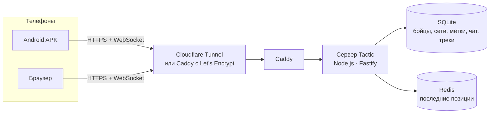
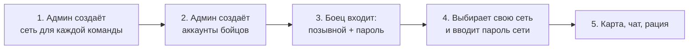

<div align="center">

# Tactic — C2 / Intercom

**Тактическая карта и PTT-рация для страйкбола на вашем собственном сервере**

Позиции бойцов в реальном времени, метки, зоны, маршруты, чат и голосовая связь по отделениям —
в браузере и в Android-приложении, которое работает с выключенным экраном.

[](https://github.com/Moondancer1/tactic/actions/workflows/ci.yml)
[](https://github.com/Moondancer1/tactic/actions/workflows/android.yml)


[](LICENSE)

**Русский** · [English](README.en.md) · [Azərbaycanca](README.az.md)

</div>

---

## Содержание

- [Что это и зачем](#что-это-и-зачем)
- [Возможности](#возможности)
- [Как это устроено](#как-это-устроено)
- [Быстрый старт](#быстрый-старт)
- [Требования](#требования)
- [Развёртывание](#развёртывание)
  - [Способ А — домашний ПК с Windows](#способ-а--домашний-пк-с-windows)
  - [Способ Б — Linux VPS](#способ-б--linux-vps)
- [Первая игра: админ-панель, сети и бойцы](#первая-игра-админ-панель-сети-и-бойцы)
- [Для бойцов: как пользоваться](#для-бойцов-как-пользоваться)
- [Android-приложение (APK)](#android-приложение-apk)
- [Настройки сервера (переменные окружения)](#настройки-сервера-переменные-окружения)
- [Обновление и резервные копии](#обновление-и-резервные-копии)
- [Безопасность](#безопасность)
- [Решение проблем](#решение-проблем)
- [Разработка](#разработка)
- [Структура проекта](#структура-проекта)
- [Документация](#документация)
- [Лицензия](#лицензия)

---

## Что это и зачем

Во время страйкбольной игры команде нужно понимать **кто где находится**, **где противник** и **как быстро передать команду**. Обычно это рации, бумажная карта и крики. Tactic объединяет всё в одном приложении на телефоне:

- каждый боец видит своих на карте в реальном времени;
- контакт с противником отмечается двумя касаниями и сразу виден всей команде;
- командир рисует зоны, маршруты и цели, пишет брифинг;
- голосовая связь работает как рация: нажал кнопку — говоришь, отпустил — слушаешь.

Сервер вы поднимаете **сами**: на домашнем ПК или на арендованном VPS. Никаких сторонних облачных сервисов, подписок и чужих серверов, на которых лежат позиции вашей команды.

> **Одна сеть = одна команда.** Для игры двух сторон администратор создаёт две сети с разными паролями. Противник, даже имея аккаунт на сервере, не увидит вашу карту без пароля вашей сети.

---

## Возможности

### Карта
- Слои **SAT** (спутник Esri World Imagery), **2D** (векторная схема OpenFreeMap), **3D** (здания при наклоне двумя пальцами), **TOPO** (OpenTopoMap).
- **Офлайн-карта**: перед игрой скачайте район полигона — карта будет работать без интернета.
- Позиции бойцов в реальном времени: позывной, отряд, роль, сектор взгляда (по компасу с учётом магнитного склонения), статус и заряд батареи. Если от бойца давно нет данных, его значок тускнеет.
- Тактическая сетка UTM **50 / 100 / 250 м** с именами секторов, перекрестие в центре экрана с координатами **MGRS**, дальностью и азимутом от вас и от ближайшего ориентира.
- Кнопка **ME**: центрировать карту на себе и сразу отправить свежую позицию.

### Тактические обозначения
| Инструмент | Что делает | Кто может |
|---|---|---|
| **ENEMY** | Контакт с противником (тип, количество, движение, таймер исчезновения) | все |
| **MEDIC / DANGER** | Быстрые метки «нужен медик» и «опасная зона» на вкладке SPOT | все |
| **RULER** | Линейка: дальность, азимут истинный / магнитный, в тысячных | все |
| **OBJ** | Цель со статусом (активна / захвачена / потеряна / зачищена) | командиры |
| **TRP** | Именованный ориентир для целеуказания голосом («от ДУБА 200 на север») | командиры |
| **WPT** | Путевая точка | командиры |
| **ROUTE** | Маршрут отряда со стрелками | командиры |
| **ZONE** | Зона (своя, вражеская, нейтральная, цель, запретная) со штриховкой | командиры |

Командиры — это роли **Squad leader** и **Commander**. Чтобы стать командиром в игре, нужен **PIN командира** этой сети.

### Голос (Push-To-Talk)
- Три канала: **SQD** (своё отделение), **ALL** (все в сети), **CMD** (только командиры).
- Работает как рация: пока говорит один, канал занят. Второй говорящий увидит «Канал занят».
- Голос идёт через тот же защищённый канал, что и карта: работает через мобильный интернет и туннели, открывать UDP-порты не нужно.
- Кнопки: экранная кнопка PTT, **пробел** на компьютере, **кнопка гарнитуры** и (по желанию) **качелька громкости** на Android — даже при заблокированном экране.

### Связь и командование
- Чат по каналам **ALL / SQUAD / CMD** с автоматической озвучкой входящих сообщений (TTS, русский и английский).
- Статусы бойца **OK / HIT / MEDIC / OUT**: при смене статуса отделение получает сообщение с местом.
- **Брифинг** от командира виден всем в сети.
- Вкладка **TEAM**: кто в сети, кто офлайн, кнопка «НА КАРТУ» к любому бойцу.

### Android-приложение
- Работает с **выключенным экраном**: фоновый сервис сам отправляет GPS и держит голосовую связь.
- Режимы питания: **COMBAT** (позиция каждые 2 с, экран не гаснет) и **ECO** (каждые 5 с). Если боец стоит на месте или экран выключен — раз в 15 с.
- Команде уходят только свежие и точные координаты, без «прыжков» GPS.
- Графика **АВТО / ПОЛНАЯ / ЛЁГКАЯ**: на слабом телефоне — или если карта начинает тормозить при прокрутке — приложение само включает облегчённую графику (меньше пикселей, без теней и анимаций).

---

## Как это устроено



| Компонент | Технологии |
|---|---|
| Сервер | Node.js 22+, Fastify, WebSocket, встроенный SQLite (`node:sqlite`), Redis, JWT |
| Веб-клиент | React 18, Zustand, MapLibre GL, PWA |
| Android | Capacitor 7 + собственный плагин и фоновый сервис (Java) |
| Развёртывание | Docker Compose, Caddy (HTTPS), Cloudflare Tunnel |

Все данные — бойцы, сети, метки, чат и треки — хранятся **только на вашем сервере** в папке `data/` (на ПК) или в Docker-томе (на VPS).

---

## Быстрый старт

Самый простой путь — домашний ПК с Windows и временный адрес от Cloudflare (домен не нужен):

```powershell
git clone https://github.com/Moondancer1/tactic.git
cd tactic
powershell -ExecutionPolicy Bypass -File scripts\local.ps1
```

1. На первый вопрос нажмите **Enter** (без домена), на вопрос о пароле — тоже **Enter**: скрипт придумает надёжный пароль сам.
2. Через 3–10 минут скрипт напечатает адрес `https://….trycloudflare.com` и логин/пароль администратора.
3. Откройте адрес → **Админ-панель** → создайте сеть и бойцов → бойцы входят со своих телефонов.

Подробно о каждом шаге — ниже.

---

## Требования

| Где запускаете | Что нужно |
|---|---|
| **Домашний ПК** | Windows 10/11 с [Docker Desktop](https://www.docker.com/products/docker-desktop/). Node.js, Java и Android Studio **не нужны** — всё собирается внутри Docker. |
| **VPS** | Ubuntu 22.04/24.04 или Debian 12, 1–2 vCPU, 1–2 ГБ RAM (на 30–60 игроков хватает 2 vCPU), публичный IPv4, домен с A-записью на сервер. |
| **Телефоны** | Android 6.0+ (APK) или любой современный браузер. Нужны GPS и разрешение на микрофон. |

> **Важно.** Сервер должен открываться **по HTTPS**. Без HTTPS браузер не даст сайту ни геолокацию, ни микрофон, а APK принимает только HTTPS. Оба способа ниже настраивают HTTPS автоматически.

---

## Развёртывание

### Способ А — домашний ПК с Windows

Сервер работает на вашем компьютере, а телефоны подключаются к нему через **Cloudflare Tunnel** — бесплатный защищённый туннель. Белый IP и проброс портов на роутере **не нужны**.

#### Вариант 1. Со своим доменом (постоянный адрес)

Нужен домен, подключённый к Cloudflare (бесплатный тариф подходит).

1. Откройте [Cloudflare Zero Trust](https://one.dash.cloudflare.com/) → **Networks → Tunnels** → **Create a tunnel** → тип **Cloudflared** → имя, например `tactic`.
2. Скопируйте **токен туннеля** — длинную строку, которая начинается с `eyJ`.
3. На вкладке **Public Hostname** добавьте маршрут:

   | Поле | Значение |
   |---|---|
   | Subdomain | `tactic` |
   | Domain | ваш домен |
   | Service Type | `HTTP` |
   | URL | `caddy:80` |

4. Запустите в PowerShell из папки проекта:
   ```powershell
   powershell -ExecutionPolicy Bypass -File scripts\local.ps1
   ```
5. Скрипт спросит:
   - **адрес** — введите `https://tactic.ваш-домен.com`;
   - **токен туннеля** — вставьте токен из шага 2;
   - **пароль админа** — введите свой (от 10 символов) или нажмите Enter, чтобы скрипт сгенерировал случайный.

   Ответы сохранятся в файл `.env.local` вместе со случайным `JWT_SECRET`. Этот файл — **ваши секреты**: он не попадает в git, храните его копию в надёжном месте.

#### Вариант 2. Без домена (временный адрес)

Запустите тот же скрипт и на первый вопрос нажмите **Enter**. Cloudflare выдаст адрес вида `https://xxxx.trycloudflare.com`, скрипт его напечатает.

> Временный адрес **меняется при каждом перезапуске туннеля** — бойцам придётся вводить его заново. Для регулярных игр используйте свой домен.

#### Управление сервером на ПК

| Действие | Команда |
|---|---|
| Запустить или обновить после `git pull` | `powershell -ExecutionPolicy Bypass -File scripts\local.ps1` |
| Остановить (база в `data\` сохраняется) | `powershell -ExecutionPolicy Bypass -File scripts\local.ps1 -Down` |
| Посмотреть логи сервера | `docker compose -f docker-compose.local.yml logs -f app` |

Подробнее: [docs/LOCAL.md](docs/LOCAL.md).

---

### Способ Б — Linux VPS

Сервер получает бесплатный HTTPS-сертификат Let's Encrypt автоматически.

1. В DNS вашего домена создайте **A-запись**, например `tactic.example.com` → IP вашего VPS.
2. Установите Docker и скачайте проект:
   ```bash
   curl -fsSL https://get.docker.com | sudo sh
   git clone https://github.com/Moondancer1/tactic.git
   cd tactic
   ```
3. Запустите установщик со своим доменом и email (для уведомлений Let's Encrypt):
   ```bash
   sudo ./scripts/install.sh tactic.example.com admin@example.com
   ```

Установщик сам:
- проверит систему, Docker, DNS-запись и свободны ли порты **80/443**;
- создаст файл `.env` со **случайными** секретами (`JWT_SECRET`, `ADMIN_PASSWORD`, `ADMIN_TOKEN`) и покажет логин админ-панели;
- откроет порты в `ufw` (если он включён), соберёт и запустит контейнеры `caddy`, `app`, `redis`;
- проверит, что сервер отвечает.

> **Порты 80/443 уже заняты** другим nginx/Caddy? Установщик сам переключится в режим `proxy`: Tactic будет слушать `127.0.0.1:8088`, а ваш прокси должен перенаправлять на него домен (с поддержкой WebSocket). Пример конфигурации nginx — в [docs/DEPLOY.md](docs/DEPLOY.md).

Только проверить сервер, ничего не меняя:
```bash
sudo ./scripts/install.sh --check tactic.example.com admin@example.com
```

---

## Первая игра: админ-панель, сети и бойцы



1. **Откройте админ-панель.** Откройте адрес сервера → внизу экрана входа **«Админ-панель (бойцы и сети)»** → логин и пароль администратора из `.env.local` (ПК) или `.env` (VPS). Логин по умолчанию — `administrator`.

2. **Создайте сети.** Блок **«Новая сеть»**:
   - **Название** — например `Op. Nightfall — СИНИЕ`;
   - **Пароль сети** (от 4 символов) — сообщите его **только своей команде**;
   - **PIN командира** — оставьте пустым, сервер сгенерирует случайный из 6 цифр.

   PIN каждой сети виден в списке **«Активные сети»**. Сообщите его только командирам.

3. **Создайте бойцов.** Блок **«Добавить / обновить бойца»**: позывной (2–16 символов: буквы, цифры, дефис), пароль (от 6 символов), отряд и роль по умолчанию.
   - **ИЗМ.** — сменить пароль, отряд или роль. Новый пароль сразу отключает все старые сессии бойца.
   - **КИК** — мгновенно выкинуть бойца из всех сетей; ему придётся войти заново.
   - **✕** — удалить аккаунт.

4. **Бойцы входят.** На телефоне: позывной и пароль → список сетей → своя сеть → пароль сети.

5. **После игры** нажмите **ЗАВЕРШИТЬ** у сети — все бойцы отключатся, а история (чат, треки) сохранится на срок `RETENTION_DAYS`.

### Роли и права

| Кто | Что может |
|---|---|
| **Любой боец** | Видеть карту своей сети, ставить контакты / MEDIC / DANGER, удалять **свои** метки, подтверждать чужой контакт («STILL THERE»), писать в ALL и в свой отряд, говорить в SQD и ALL |
| **Командир** (Squad leader, Commander) | Всё выше + цели, ориентиры, путевые точки, маршруты, зоны, брифинг, удаление любых меток, канал CMD |
| **Администратор** | Создавать и завершать сети, управлять аккаунтами (через админ-панель или API) |

Стать командиром в игре: вкладка **TEAM** → выбрать роль командира или отряд HQ → ввести **PIN командира**. После 5 неверных попыток ввод PIN блокируется на 15 минут.

---

## Для бойцов: как пользоваться

| Элемент экрана | Назначение |
|---|---|
| **Верхняя панель** | Название сети (нажмите, чтобы сменить сеть), **● X/Y В СЕТИ**, качество связи, режим питания **COMBAT / ECO** |
| **Левая панель инструментов** | RULER, ENEMY и (для командиров) TRP, OBJ, WPT, ROUTE, ZONE |
| **Кнопки карты** | Слои и сетка, север вверх, сетка вкл/выкл, **ME** — к себе |
| **Кнопка PTT** | Нажать и держать — говорить. Сверху выбирается канал SQD / ALL / CMD |
| **Шторка снизу** | Вкладки **CHAT**, **SPOT** (донесение о противнике), **BRIEF** (брифинг), **TEAM** (бойцы, статус, роль), **SETTINGS** |

**Отметить противника:** долгое нажатие на карте (или инструмент ENEMY) → вкладка SPOT → тип, количество, движется ли, через сколько метка исчезнет → **отправить**. Контакт увидят все, а в чат уйдёт строка с координатами.

**Перед игрой обязательно:** Настройки → **ОФЛАЙН-КАРТА** → скачать район полигона для каждого нужного слоя.

---

## Android-приложение (APK)

### Где взять

- **С вашего сервера:** `https://ваш-адрес/tactic.apk` — отдаётся, если вы собрали APK (см. ниже).
- **Из GitHub Actions** — если в репозитории настроены секреты подписи (см. [docs/ANDROID.md](docs/ANDROID.md)).

### Сборка

```powershell
powershell -ExecutionPolicy Bypass -File apk\build-apk.ps1
```

- Адрес сервера из `PUBLIC_URL` в `.env.local` вшивается в приложение — бойцам не придётся его вводить. Другой адрес: параметр `-Server https://tactic.example.com`.
- Если Node.js, JDK 21 и Android SDK не установлены, сборка идёт **внутри Docker** (первый раз — 5–15 минут).
- Результат: **`apk\out\tactic.apk`** — сервер сразу начинает раздавать его по ссылке `/tactic.apk`.
- Собирается только **release-версия, подписанная вашим ключом**.

> **Ключ подписи — самое важное.** При первой сборке создаётся файл `apk\keystore\tactic-release.jks`, а его пароли дописываются в `.env.local`. **Сохраните оба в надёжное место** (например, в приватный репозиторий). Если ключ потерять, новые версии не установятся поверх старой — каждому бойцу придётся удалять приложение и ставить заново.

### Установка на телефон

1. Скачайте APK и откройте его, разрешите установку из неизвестных источников.
2. Войдите и разрешите **геолокацию**, **микрофон** и **уведомления**.
3. Настройки → **ФОНОВАЯ РАБОТА** → разрешить работу в фоне (отключает оптимизацию батареи).
4. На Xiaomi, Huawei, Samsung дополнительно включите автозапуск и снимите ограничения фона для Tactic (инструкции для своей модели: [dontkillmyapp.com](https://dontkillmyapp.com)).
5. Скачайте офлайн-карту.

Когда приложение работает в фоне, в шторке уведомлений висит «Tactic: GPS … · radio listening». Кнопка **Stop** в уведомлении останавливает фоновую работу.

---

## Настройки сервера (переменные окружения)

Задаются в `.env.local` (ПК) или `.env` (VPS). Скрипты `local.ps1` и `gen-env.sh` создают их сами.

| Переменная | Обязательна | Описание |
|---|---|---|
| `JWT_SECRET` | да | Ключ подписи сессий, от 32 случайных символов |
| `ADMIN_USER` | — | Логин админ-панели (по умолчанию `administrator`) |
| `ADMIN_PASSWORD` | да* | Пароль админ-панели, от 10 символов. Пусто — админ-панель отключена |
| `ADMIN_TOKEN` | — | Токен для скриптов и webhook (`Authorization: Bearer …`) |
| `RETENTION_DAYS` | — | Сколько дней хранить чат, треки и завершённые сети (по умолчанию `30`) |
| `CORS_ORIGINS` | — | Дополнительные адреса, которым разрешено обращаться к API (через запятую). Само приложение в этом не нуждается |
| `DOMAIN`, `ACME_EMAIL` | VPS | Домен и email для сертификата Let's Encrypt |
| `PUBLIC_URL` | ПК | Адрес сервера: его показывает `local.ps1` и вшивает в APK `build-apk.ps1` |
| `CLOUDFLARE_TUNNEL_TOKEN` | ПК | Токен именованного туннеля. Пусто — временный адрес trycloudflare.com |
| `TACTIC_KEYSTORE_PASSWORD`, `TACTIC_KEY_ALIAS`, `TACTIC_KEY_PASSWORD` | APK | Пароли ключа подписи (создаются автоматически) |

\* В рабочем режиме сервер **откажется запускаться**, если секреты короче минимума или совпадают со значениями из примеров `.env.example` / `.env.local.example`. Это защита от случайного запуска с публично известными паролями.

---

## Обновление и резервные копии

**Обновить на ПК:**
```powershell
git pull
powershell -ExecutionPolicy Bypass -File scripts\local.ps1
```

**Обновить на VPS:**
```bash
git pull
sudo ./scripts/install.sh tactic.example.com admin@example.com
```

Бойцы переподключаются автоматически, база данных при обновлении сохраняется и при необходимости сама переводится на новую структуру.

**Резервная копия:**
- **ПК:** скопируйте папку `data\` (лучше при остановленном сервере) и файл `.env.local` вместе с `apk\keystore\`.
- **VPS:** команда из [docs/DEPLOY.md](docs/DEPLOY.md#7-резервные-копии) делает копию базы без остановки.

**Разбор после игры:** треки всех бойцов (точка раз в 10 секунд) — `GET /api/admin/matches/<id>/tracks` с правами администратора.

---

## Безопасность

Tactic проектировался с учётом того, что **противник тоже может иметь телефон, аккаунт и желание подсмотреть**.

- **Изоляция команд.** Карта, метки и чат одной сети недоступны другой. Список сетей виден только после входа, коды сетей не раскрываются, пароль сети обязателен.
- **Пароли не хранятся на телефоне.** После входа приложение хранит только отзываемый тикет.
- **Мгновенный отзыв доступа.** КИК, удаление и смена пароля бойца сразу обрывают все его сессии, в том числе фоновую отправку GPS.
- **Защита от подбора.** Ограничения считаются по аккаунту, а не по IP (за туннелем у всех один IP): 10 попыток входа, 8 попыток пароля сети и 5 попыток PIN за 15 минут.
- **Честные позиции.** Время ставит сервер, «телепорты» быстрее 40 м/с и грубые фиксы отбрасываются.
- **Чужие метки не трогаются.** Изменить или удалить метку может только автор или командир.
- **Защита веб-клиента.** Политика CSP запрещает выполнение любых скриптов, кроме файлов самого приложения.
- **Защищённый APK.** Release-сборка, без резервного копирования данных, без отладки, только HTTPS и только системные сертификаты.
- **Автотест.** [`server/test/security-smoke.mjs`](server/test/security-smoke.mjs) проверяет все защиты сквозным сценарием и запускается в CI при каждом изменении.

Нашли уязвимость? Пожалуйста, не публикуйте её в открытых Issues — свяжитесь с автором репозитория напрямую.

---

## Решение проблем

| Проблема | Что делать |
|---|---|
| Браузер не даёт GPS или микрофон | Сайт открыт не по HTTPS. Используйте адрес `https://…` |
| «Неверный позывной или пароль» | Проверьте раскладку. Аккаунты создаёт только администратор |
| «Слишком много неудачных попыток» | Подождите 15 минут или попросите админа сменить пароль |
| Сервер не запускается, в логе `is a public example value` | В `.env` / `.env.local` остался пример. Удалите строку и запустите `local.ps1` (ПК) или `gen-env.sh` (VPS) |
| «Канал занят» при нажатии PTT | В этом канале уже говорит другой боец — дождитесь конца передачи |
| Позиция не обновляется с выключенным экраном | Разрешите фоновую работу (раздел [Установка на телефон](#установка-на-телефон)) |
| Новый APK не устанавливается поверх старого | Он подписан другим ключом. Удалите старое приложение и установите новое |
| Временный адрес trycloudflare перестал работать | Он меняется при перезапуске. Возьмите новый из вывода `local.ps1` или используйте свой домен |
| Красная точка и `NET…` в верхней панели | Нет связи с сервером, приложение переподключается само. Если не помогает и используется свой прокси — проверьте, что он пропускает WebSocket |

---

## Разработка

```bash
npm install
npm run dev          # сервер на :3000 + Vite с горячей перезагрузкой
npm run typecheck    # проверка типов всех пакетов
npm run build        # сборка сервера и клиента
```

В режиме разработки админ-панель доступна по логину `admin` / паролю `admin`.

Сквозной тест безопасности против запущенного сервера в режиме разработки:
```bash
npm run build -w server
cd server && DATA_DIR=./data-test node dist/index.js &
node test/security-smoke.mjs http://127.0.0.1:3000
```

Протокол REST и WebSocket описан в [docs/PROTOCOL.md](docs/PROTOCOL.md). Pull request'ы приветствуются: перед отправкой убедитесь, что `npm run typecheck` и тест безопасности проходят.

---

## Структура проекта

```text
tactic/
├── shared/src/index.ts          # Протокол: типы и схемы сообщений, роли, отряды, каналы, права
├── server/
│   ├── src/
│   │   ├── index.ts             # Fastify, CORS, раздача PWA, корректная остановка
│   │   ├── config.ts            # Настройки и проверка секретов при запуске
│   │   ├── auth.ts              # Сессии и тикеты (JWT) с мгновенным отзывом
│   │   ├── db.ts                # SQLite: бойцы, сети, метки, чат, треки + миграции
│   │   ├── hub.ts               # Комнаты сетей: позиции, права, голос, лимиты
│   │   ├── ws.ts                # WebSocket: вход и обмен сообщениями
│   │   └── routes.ts            # REST API
│   ├── test/security-smoke.mjs  # Сквозной тест защит
│   └── Dockerfile
├── client/
│   ├── src/                     # React-приложение: карта, рация, чат, админ-панель
│   └── android/                 # Android-проект (MainActivity, TacticalPlugin, TacticalService)
├── apk/                         # Сборка APK: build-apk.ps1, Dockerfile, keystore/ (не в git), out/
├── deploy/                      # Конфигурации Caddy
├── scripts/                     # local.ps1 (ПК), install.sh и gen-env.sh (VPS)
├── docs/                        # Подробная документация
├── docker-compose.yml           # Стек для VPS: caddy + app + redis
├── docker-compose.local.yml     # Стек для ПК: app + redis + caddy + Cloudflare Tunnel
└── docker-compose.proxy.yml     # Надстройка для VPS, где порты 80/443 уже заняты
```

---

## Документация

| Документ | О чём |
|---|---|
| [docs/LOCAL.md](docs/LOCAL.md) | Запуск на своём компьютере |
| [docs/DEPLOY.md](docs/DEPLOY.md) | VPS: порты, прокси, создание сетей через API, резервные копии, диагностика |
| [docs/ANDROID.md](docs/ANDROID.md) | Android: фоновый режим, сборка, подпись, GitHub Actions |
| [docs/PROTOCOL.md](docs/PROTOCOL.md) | REST, WebSocket, токены, лимиты, webhook для судейских скриптов |
| [docs/TESTING.md](docs/TESTING.md) | Автотесты и чек-лист полевой проверки перед игрой |

---

## Лицензия

Проект распространяется по лицензии **[PolyForm Noncommercial 1.0.0](LICENSE)**.

| Можно — бесплатно и без спроса | Нельзя без письменного разрешения автора |
|---|---|
| Пользоваться для себя, своей команды и любительских игр | Продавать программу или её изменённую версию |
| Разворачивать на своём сервере | Делать на её основе платный сервис или подписку |
| Изучать и изменять код | Использовать в коммерческой деятельности, например на платном полигоне |
| Делиться копиями, в том числе изменёнными, сохраняя файл [LICENSE](LICENSE) и строку `Required Notice` с автором | Убирать указание автора и условия лицензии |

Некоммерческие организации — благотворительные, учебные, государственные — тоже могут пользоваться бесплатно.

Хотите использовать Tactic коммерчески? Свяжитесь с автором через [GitHub](https://github.com/Moondancer1) — обсудим отдельное разрешение.

Copyright © 2026 [Moondancer1](https://github.com/Moondancer1).
